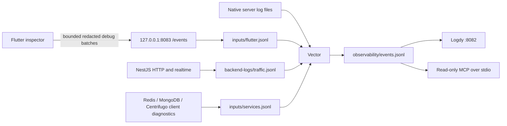

# Local logs with Vector, Logdy and MCP

Vector collects this workspace's logs into one private JSONL file. Logdy displays that file; the existing read-only MCP server queries it. Collection, storage and viewing use this Mac, with no Docker or hosted logging service. The configured AI host still receives the MCP results it requests.

To compare the same capture and retained history in Loki and Grafana alongside Logdy, use the separate [local Grafana comparison](LOKI_GRAFANA.md). It reads the existing Vector output through Alloy without changing this collector or its destinations.



## Start and connect

From `backend/`, install the pinned native tools once:

```sh
npm run logs:collector:install
npm run logs:install
```

Run these in separate terminals:

```sh
npm run logs:collector
```

```sh
npm run logs
```

Open [Logdy](http://127.0.0.1:8082/). The collector accepts Flutter events at `http://127.0.0.1:8083/events`; [its local health endpoint](http://127.0.0.1:8083/health) reports ingress counters. Neither command starts or restarts the API, Flutter, Redis, MongoDB or Centrifugo. Ctrl-C stops only that command's own processes.

Logdy keeps a rolling 10,000-row browser view and a 10,000-row server ring; the JSONL capture and MCP history are independent of those viewer limits. Its browser clients initially pause live following. **Play** follows future arrivals; **Resume incoming messages where paused** also requests the retained backlog. If an existing view remains stale, reload Logdy to fetch the current tail, then enable following. Source facets describe the current browser window, so a quiet service may disappear from that window while its records remain searchable through MCP.

Use only one viewer page per origin: Logdy pages share storage and warn about
duplicate tabs. Following now survives a WebSocket reconnect through the local
verified-asset compatibility fix; manually paused pages remain paused. For
outbound queue status, retries, counts and genuine backend recovery events, use
`data.category in ("outbox", "health")` in the search field, followed by Enter.
See [live queue diagnostics](BACKEND_LOGGING.md#live-outbound-queue-and-recovery)
for the field meanings and resume controls.

Persisted browser log rows have a separate 2 MiB cache budget with oldest-row
eviction and an in-memory fallback when storage is unavailable. This keeps
incoming logs and saved filters working without clearing application settings.
Reloaded browser history can be smaller than the 10,000-row live-view limit;
the server ring and JSONL/MCP history are unaffected.

When starting the API yourself, use `npm run start:debug` in `backend/`. It defaults to the existing traffic capture plus `LOCAL_SERVICE_LOG_FILE=../.runtime/observability/inputs/services.jsonl` (resolved to an absolute workspace path by the launcher). Explicit shell settings override `.env`, which overrides defaults. A running API must be restarted manually to load new instrumentation and settings. Ordinary `start:dev` needs explicit file settings; `LOCAL_SERVICE_LOG_FILE=off` disables service diagnostics independently of HTTP/full traffic logging.

The existing MCP registration command is unchanged. Build with `npm --prefix tools/backend-logs-mcp run build` from the root, then reconnect that MCP host after starting the collector. Its default selects the unified capture when present; otherwise it selects the legacy backend capture. Selection is fixed per connection. See [MCP installation and queries](tools/backend-logs-mcp/README.md).

In the current installed desktop build, **Settings → MCP servers** opens the MCP management view. The circular-arrow **Restart** control is in the **Servers section header beside Add** and appears only while settings changes are pending. Toggle the existing `chat-backend-logs` entry off and back on to mark that host for restart. This restarts the app-server host, rather than just one MCP process. The existing chat's five-tool connection must still be checked afterward; a fresh worker connection alone does not prove that it refreshed.

For this authorized restart workflow, the backend, collector and Logdy were gracefully restarted as independent background processes with no controlling terminal; Centrifugo was already independent. They have parent PID 1 and separate process groups, so they are not tied to the old app-server's terminal sessions. Private stdout/stderr files are `.runtime/observability/backend-process.log`, `collector-process.log` and `logdy-process.log`; `.runtime/observability/independent-services.json` records their current process IDs. No login/startup service was installed. Check existing listeners before starting duplicate foreground commands. Flutter development listeners may need restarting if the desktop host stops its existing managed run sessions; existing browser apps can continue running until reloaded.

## How each source connects

| Source      | Records delivered                                                                                                                                                                                                                                                                                                                     | Connection and limits                                                                                                                                                                                                                                                                                        |
| ----------- | ------------------------------------------------------------------------------------------------------------------------------------------------------------------------------------------------------------------------------------------------------------------------------------------------------------------------------------- | ------------------------------------------------------------------------------------------------------------------------------------------------------------------------------------------------------------------------------------------------------------------------------------------------------------ |
| Flutter Web | Inspector timeline events shown in the app, with explicit pressure sampling of widget/watch instant events: category/name, begin/end/instant, trace/span/parent, UTC time, duration, user/room/session and approved metadata. Explicit Refresh also sends current gauges, widget counts, frame availability and operation aggregates. | Opt-in HTTP batches to the local ingress, which appends the Flutter input file. Browser tabs have distinct random instance IDs. Ordinary metadata is independent of full debug traffic logging; HTTP/realtime payload details and SQLite inputs/results additionally require that opt-in.                    |
| Backend     | Existing redacted HTTP completions, optional HTTP request/response JSON and realtime publish attempts.                                                                                                                                                                                                                                | Existing private traffic file, tailed by Vector. Match `requestId` to Flutter HTTP records and backend service operations where that ID exists.                                                                                                                                                              |
| Redis       | Backend-client command/connection names, result, duration and error class. Native Redis server diagnostics when its log file exists.                                                                                                                                                                                                  | ioredis instrumentation writes the service input. Vector also tails `/opt/homebrew/var/log/redis.log`. Metadata mode excludes command inputs/replies. Effective full debug mode includes supported redacted keys, named Lua arguments/source and final replies (see below). No `MONITOR` connection is used. |
| MongoDB     | Backend-client commands, database/collection, query/write documents and final reply batches in effective full debug mode; metadata-only command names, outcome, duration and error class otherwise.                                                                                                                                   | Driver monitoring uses the existing backend connection. Native server diagnostics remain separate, with native JSON attributes excluded. Full command/reply snapshots are redacted and bounded as described below.                                                                                           |
| Centrifugo  | Each publish attempt, batched presence query, connected-client lookup and disconnect request/result; native startup/connection/warning diagnostics. Full debug mode adds redacted provider request/response bodies. Flutter inspector records actual receipt separately.                                                              | Client diagnostics enter the service input. Vector attaches the workspace's `.runtime/observability/inputs/centrifugo-server.log` when present; `LOCAL_CENTRIFUGO_LOG_FILE` overrides it and `off` disables native collection.                                                                               |

Backend-client diagnostics have `origin: backend_client`; native server lines have `origin: server_log`. These are different observations. Client operations do not expose other clients' operations or complete server internals. Redis contains current projections, not message history. No new database message event log is introduced.

The `centrifugo.publish` client record includes `actorUserId` (the initiating actor, also retained as `userId`), `recipientUserId`, the exact destination `channel`, `eventType` and `pts`. When the existing full debug traffic policy is enabled, its expandable raw JSON also includes the credential-redacted `data` sent to Centrifugo and `responseBody`. For a new message, its sender is `data.room.lastMessage.senderId`; that sender can differ from the actor for receipts or other room updates. Payload capture remains off when debug logging is disabled, including production unless explicitly overridden. MCP returns bodies only with `includePayloads: true`. Existing record-size limits can omit oversized bodies. Historical records are unchanged; provider success still means acceptance rather than peer receipt.

New backend-client records use `name: <source>.<operation>` and `category: command` or `connection`. Existing event/operation fields remain compatible, and historical records are not rewritten. In Logdy, **Operation / event** displays the most specific available name; the hidden **Event kind** facet shows the original event type. Use **Source**, **Category**, **Observer**, **Request ID**, **Instance** and **Trace ID** to distinguish the service, observation and causal scope.

With effective full debug traffic logging enabled, Redis records also populate **What happened** (`summary`). Expand a row to inspect `data.command`, `data.keys`, `data.arguments` and `responseBody`. Known application Lua scripts include `data.script.name`, exact `source`, SHA-1 and `possibleCommands`; their arguments have `KEYS[n]` / `ARGV[n]` positions and descriptive names, with JSON room inputs/replies decoded into expandable objects. For example, `inbox.read_delta` validates the epoch/revision window and reads changed cached rooms; an empty Redis reply requests full sync. `inbox.upsert_room` updates the latest room projection/revision and TTL. Match the row's request ID to the HTTP record for its route, query and response. Existing historical records cannot recover details that were never captured.

These are the actual client command inputs and final reply, not Redis-internal tracing: `possibleCommands` describes commands present in the Lua source and does not prove which branches ran or expose intermediate values. No Redis MONITOR, extra key reads or data mutations are added. Details use the same development/explicit production-override policy and recursive credential redaction as HTTP/realtime debug capture. Binary values retain size metadata. Authentication/configuration commands, sensitive keys, unknown scripts and unsupported positional commands omit their values/replies. Metadata-only mode does not inspect command arguments. Full Redis debug capture can contain private room/message data and remains in the existing private bounded local capture.

MongoDB full debug rows have **What happened**, filterable **Database** and **Collection** facets, and the driver request ID alongside the causative HTTP request ID. Expand `data.command` for the actual filter, projection, sort, limit, aggregation pipeline, inserted documents, update/delete predicates and changes, transaction/read/write options or `getMore` cursor. `responseBody` contains the server reply: `cursor.firstBatch` / `nextBatch`, a returned `value`, counts such as `n` / `nModified`, or write error codes. Cursor batches are separate commands, not an invented combined result. A successful driver command can still contain `writeErrors` / `writeConcernError`; inspect that reply and the HTTP outcome. Writes are not followed by extra diagnostic reads. Object IDs, long cursor/transaction numbers and other BSON scalars keep readable Extended JSON types; dates use ISO strings and binary values expose byte size only.

Mongo snapshots redact credential keys (including dotted paths), expression operands referencing credential fields, and encoded JSON credentials. Raw exception messages/stacks and server `errmsg` text are excluded; failed-command replies retain safe numeric error codes, code names and labels. Authentication and unsupported commands omit contents/replies. Each command/reply snapshot has a 256 KiB limit and explicit omission metadata. Pending commands share a 4 MiB detail budget plus bounded tracking metadata, preserving the existing 4,096-command / 60-second correlation bounds. Capacity omissions remain visible and completed operations keep their identity/outcome. Metadata mode never reads command documents, database names or replies. Native MongoDB server records still omit arbitrary attributes and are not backend query traces.

Centrifugo `batch`, `presence` and `disconnect` rows now describe the provider exchange, with `data.requestBody`, HTTP status/timeout and `responseBody` in full debug mode. API keys/headers and session credentials are excluded. These rows describe provider responses; presence-shape validation and the final HTTP outcome remain separate. Publish summaries retain their stable publication ID, recipient, attempts and acceptance result. Backend HTTP rows also have a concise **What happened** summary; full query/body/header data remains behind the existing debug policy. All sources retain the same request ID for correlation and the existing bounded private JSONL/Vector path.

For publication inspection, select source **centrifugo**, operation **centrifugo.publish**. **Channel** and **Result** are visible columns; expand the raw JSON for `channel`, `data` (the exact sent publication data after credential redaction), `responseBody`, HTTP `status`, `method`/`path`, recipient, actor, attempt and publication ID. The same publication ID and payload snapshot persist across retries; records represent individual attempts. Successful publication normally returns `{"result":{}}` when history is disabled. Provider acceptance does not prove a subscribed client received or applied the publication. Native `server_log` rows remain credential-filtered server diagnostics; the backend-client publish row is the source for application payloads.

Presence batches retain `data.channels` and `data.requestBody.commands`; the response's `replies` entries correspond by index. The Channel column also shows these batch channels. HTTP 200 with an individual provider error is marked failed without changing caller validation or the wire request. Malformed JSON responses retain status and an explicit `unreadable_json_response` omission instead of raw response text. Each full-debug request/publication or response snapshot is capped at 64 KiB with `detail_byte_limit` metadata; operation identity/outcome remain available. Metadata mode retains publication routing and outcomes while excluding payloads/replies. These semantics were checked against the [official Centrifugo server API](https://centrifugal.dev/docs/server/server_api) on 2026-10-17.

| Source     | Useful names / event types                                                  | Category or grouping                                                         |
| ---------- | --------------------------------------------------------------------------- | ---------------------------------------------------------------------------- |
| Flutter    | `POST:/messages`, `inbox.publication`, `query.select`, `build:MessagesPane` | `http`, `realtime`, `drift`, `widget`; scoped by instance/session/trace/span |
| Backend    | `http_request`, `realtime_publication`                                      | Method/route/status or publication/event type; linked by request ID          |
| Redis      | `redis.eval`, `redis.get`, `redis.ready`                                    | `command` or `connection`                                                    |
| MongoDB    | `mongodb.find`, `mongodb.insert`, `mongodb.commitTransaction`               | `command` or `connection`                                                    |
| Centrifugo | `centrifugo.publish`; native `server_log`                                   | Client `command` versus native `server` with distinct observer               |

Native Redis and MongoDB lines likewise use `server_log` / `server` with their own source. A server may be quiet at its configured log level; client command diagnostics provide the request-linked operations. For example, MCP `search_logs` with `source: redis`, `name: redis.eval`, `category: command` finds Redis Lua calls, and `error_summary` keeps failed MongoDB operations in separate name/category groups.

Native JSON records preserve recognized `level` severity, including `trace`, `debug`, `fatal`, `panic` and `none`, instead of collapsing it to `info` or `error`. Levels are trimmed and lowercased; aliases such as `warning` and MongoDB `s` values map to their corresponding levels (`W` to `warn`, `E` to `error`, `F` to `fatal`, `D`/`D1`–`D5` to `debug`, `I` to `info`). Plain or unclassified lines fall back to warn/warning or error/fatal/panic keywords, with error taking precedence. Explicit levels take precedence over keywords in the diagnostic message. MCP accepts and filters all these levels; error summaries include `fatal` and `panic` in error counts.

Native Centrifugo `http request` records use `name: http.request` and retain validated `method`, `path`, numeric `status`, original Go `duration` and numeric `durationMs` (including sub-millisecond values). `route` mirrors the safe pathname for the existing Logdy Route column and MCP route filter. **What happened** displays a summary such as `POST /api/publish HTTP 200 in 158.792µs`. Paths omit query strings and fragments; credentials, headers, bodies and arbitrary provider fields are not promoted. Invalid optional fields are omitted without dropping the record. Existing captured rows are not rewritten: restart only the collector to apply this transform to newly ingested records, and rebuild/reconnect the MCP reader to load the expanded levels.

Collector/MCP contract preflight refreshed the [official Zalando guidelines](https://opensource.zalando.com/restful-api-guidelines/) on 2026-10-18: security (104), timestamp formats (169) and compatibility (106/107) informed the bounded metadata and coordinated reader schema update. MCP remains a local read-only stdio API; REST URL, OAuth and OpenAPI endpoint rules do not apply.

`LOCAL_REDIS_LOG_FILE` and `LOCAL_MONGODB_LOG_FILE` override the native defaults; set either to `off` to skip it. Shared Redis/MongoDB files begin at their current end on first attachment, then resume using Vector checkpoints. The owned filtered Centrifugo input and application inputs begin at the start, including retained owned archives, so unread records survive rotation. New native records retain a valid service time as `sourceTimestamp` and `timestamp`, with `timestampSource: service`; otherwise `timestampSource: collection` marks the fallback. `receivedAt` and `collectedAt` preserve collection timing separately. MongoDB numeric IDs become safe `sourceEventCode` values and names such as `mongodb.event.22943`; arbitrary MongoDB attributes remain excluded. `captureId` identifies the collector run that ingested a record, not the originating application session.

Launch local Centrifugo with `node scripts/centrifugo-local.mjs start`. The existing launcher validates its pinned binary/configuration, captures stdout/stderr through credential/body filtering and owns the bounded private native input. Do not point Centrifugo directly at that file or bypass the filter with raw shell redirection. The collector automatically finds this input; backend client diagnostics remain separate. Preserve the existing credentials, JWT validation and inbox rules. Do not enable payload-oriented debug verbosity merely to obtain connection diagnostics. See [Centrifugo logging options](https://centrifugal.dev/docs/server/configuration#log).

## Deliver the Flutter inspector

1. Open an existing debug Flutter Web session at [5173](http://localhost:5173/) or [5174](http://localhost:5174/).
2. Open **Workspace menu → Flutter inspector**. **Capture** and **Share with local logs** start on in debug app launches.
3. Close the inspector, reproduce the action, and reopen it. Its delivery status reports accepted, pending, failed and dropped records.
4. Use **Refresh counters** to also export the current overview/build/frame/slow-operation metrics. Automatic UI refreshes do not generate metric exports.
5. In Logdy, filter **Source → flutter**. Expand the original JSON for the same trace/span and duration metadata as the screenshot.

For SQLite SQL/bindings/results, **Full debug traffic logging** also starts on; use Sync diagnostics to change it. The existing Drift interceptor adds bounded `data.sqlite` to query begin/end rows; metadata mode still omits SQL and cell values. Logdy supplies SQLite **What happened**, **Database** (`chat_app_db`) and **Collection** (instrumented table names) facets. Inspector JSON and MCP `includePayloads: true` expose the same redacted details. See [SQLite query details and result semantics](FLUTTER_DEBUGGING.md#inspect-sqlite-queries-and-results). No extra database reads or mutations are performed for diagnostics.

HTTP completion rows additionally export bounded, redacted `data.http` under **Full debug traffic logging**. Expand **GET:/presence/status → data.http.query** for outgoing `userIds` and **data.http.responseBody** for the returned statuses/timestamps. The envelope includes `policy: full_debug`, `params`, `query`, `requestBody`, `requestHeaders`, `responseBody` and `responseHeaders`; absent GET bodies are null. The collector admits it only on HTTP completion rows, independently redacts credentials, and caps it at 32 KiB with explicit omission markers. Metadata-only mode omits it; disable clears retained/queued details and fences in-flight capture. See [HTTP inspection](FLUTTER_DEBUGGING.md#inspect-http-requests-and-responses).

Realtime socket rows export optional `data.realtime` with `policy: full_debug`, matching `direction` (`send`/`receive`), `operation` and bounded decoded `payload`. The collector admits this only on recognized `realtime` / `socket.<direction>.<operation>` instant rows with matching metadata. It independently redacts credentials and preserves the existing body, origin, source, batch-deduplication and acknowledgement rules. Each detail is at most 32 KiB; ordinary metadata, legacy clients and the separate application-delivery stages remain valid. See [realtime inspection and protocol boundaries](FLUTTER_DEBUGGING.md#inspect-realtime-data-sent-and-received).

HTTP/realtime collector extension preflight retrieved the [official Zalando guidelines](https://opensource.zalando.com/restful-api-guidelines/) on 2026-10-19: JSON (167), compatible optional fields (106/107), endpoint protection (104), and sensitive event data (200). Existing camelCase telemetry, local loopback/exact-origin protection and 202-after-write acknowledgements are retained. This private diagnostic ingress uses its established local security boundary rather than adding public OAuth or unrelated API infrastructure.

The existing `POST /events` accepts optional `data.sqlite` only on Flutter `drift` / `query.<operation>` events, with `policy: full_debug` and `database: chat_app_db`. Legacy batches, source/identity validation, 256 KiB body limits, exact browser origins, stable-batch deduplication and 202-after-write acknowledgements are retained. The collector never executes SQL. Supported fields are `statement`, ordered `parameters` (`position`, `storageType`, `value`), optional `result` and omission counts. Batches use `statements` and `executions` linked by `statementIndex`. Each detail is capped at 32 KiB and independently redacted. No chat API endpoint or authentication behavior changes.

Collector preflight retrieved the [official Zalando RESTful API and Event Guidelines](https://opensource.zalando.com/restful-api-guidelines/) on 2026-10-17. Applied portable security/redaction, JSON/time-format, safe-error and compatible-extension guidance (104, 169, 177, 106/107). Existing loopback/origin controls, camelCase telemetry and acknowledgement semantics are preserved; public OAuth and resource-pagination conventions do not apply to this internal diagnostic batch extension. This is not a production-compliance claim.

Debug app launches enable capture, sharing and full traffic before initialization. Sharing sends only new records; it does not replay the existing inspector ring. Capture off, Pause, Clear, sharing off and disposal retire pending delivery. Already accepted records remain in the local capture. Clear does not delete files. Inspector capture/export cannot be enabled in profile or release builds.

The exporter batches at most 50 events / 256 KiB and keeps at most 500 queued events / 1 MiB, plus one retained in-flight/retry batch of at most 50 events / 256 KiB. The initial flush waits up to 100 ms; errors/warnings and a full batch flush promptly. One request is in flight, with a two-second timeout. Widget/watch noise is capped, sampled and evicted before operation records. Fifty queue slots / 256 KiB are reserved for errors, warnings and failed HTTP outcomes. Important-only saturation still has explicit important/critical drop counters; the queue never grows without bound.

Temporary connection/timeout failures and HTTP 408/429/5xx retain the identical UUID `batchId` and body, retrying after 100/500/1000/2000 ms with a two-second cap until accepted or explicitly retired. Permanent rejection is counted separately. The loopback ingress accepts legacy batches without an ID; identified batches share an in-progress write and repeat the original 202 only after a successful write. Reusing an ID with different sanitized content returns 409. At most 16,384 receipts are retained for two minutes; capacity returns retryable 503 instead of evicting unexpired receipts. This budget is tested with two 100 ms exporters over six simulated minutes. Expiry, collector restart or a partial failed append can permit recognizable duplicate records; `instanceId`/`seq` and safe `data.logDelivery` attempt/outcome metadata distinguish those cases. This is bounded at-least-once recovery, not a durable exactly-once journal.

HTTP 202 means the complete ingress input-file append succeeded, not that it was fsynced or every downstream viewer/AI consumed it. Retrying a lost 202 is deduplicated within the receipt window. Capture off, Pause, Clear, sharing off, page reload and disposal still retire in-memory pending work under the explicit privacy policy. Inspector events and metric samples add overhead; leave sharing/capture off when unnecessary.

Producer envelopes stay below the shared 1 MiB line ceiling. Oversized application records become explicit safe omission envelopes instead of silently exceeding Vector/MCP limits. Metadata-only private status sidecars expose written/pending/dropped/failed/omitted counts, failure state and recovery times. The protected collector `/health` samples those sinks and the unified output, reporting per-source last event/collection times and measured collection lag. Health refreshes every two seconds and samples at most a 256 KiB unified-output tail; it is not a durable end-to-end acknowledgement ledger. A quiet source is not automatically a failed source; ingress acceptance, sink success, Vector liveness and observed output freshness are separate evidence.

Web delivery uses Fetch with `redirect: error` and `credentials: omit`. The default endpoint is `http://127.0.0.1:8083/events`; `--dart-define=LOCAL_LOGS_URL=...` permits only HTTP loopback endpoints. A physical mobile device's loopback is the device itself. Forward the local port explicitly before expecting native-device delivery; that transport is not device-verified here. Android/Web remain the supported targets.

## Ask AI about the same capture

Use `search_logs` with `source: flutter`, `category: realtime`, `name: inbox.publication` or `roomId`. Its metadata output preserves the screenshot's identity/phase/timing fields; request `includePayloads: true` to inspect the bounded `data` object when needed. `error_summary` groups failures across sources. `trace_request` preserves backend fanout semantics.

After the user's desktop restart on 2026-10-17, this chat's own MCP connection exposed the four tools available at that time and read the unified capture. Real bidirectional browser sends, a quoted reply and a live edit each produced a complete request trace containing Flutter, backend, Redis, MongoDB and Centrifugo records. The local E2E evidence and limits are recorded in [Validation](VALIDATION.md).

For a Flutter timeline, first obtain its `instanceId`, then call:

```json
{
  "source": "flutter",
  "instanceId": "INSTANCE_FROM_SEARCH",
  "traceId": "t19",
  "includePayloads": true,
  "limit": 100
}
```

Pass this to `trace_events`. Short IDs can repeat across tabs/restarts; the required source/instance scope prevents collisions. Add `captureId` and `sessionGeneration` when needed. Timestamp proximity alone does not establish cross-service causality or client receipt of a particular server publication. Observe each tool's coverage/warnings/cursor before claiming a complete trace.

## Rotation, archive queries and diagnostic totals

Owned JSONL streams default to a 50 MiB active-file target, seven retained archives and seven days of archive retention. Override `LOCAL_LOG_MAX_BYTES`, `LOCAL_LOG_MAX_ARCHIVES` and `LOCAL_LOG_MAX_AGE_DAYS` in the owning process environment. Unified output is checked every 30 seconds, so a busy file may briefly exceed the size target. A daily rollover also runs while data is present. Shared native Redis/MongoDB files remain under their service owners and are never truncated by workspace tooling. The workspace-owned filtered Centrifugo input uses checkpoint-aware bounded rotation. Workspace process output uses the private bounded writer below, including Vector's internal process output.

For detached runs, launch from the workspace root and redirect the wrapper's own stdout/stderr to `/dev/null`:

```bash
node scripts/private-process-log.mjs backend node scripts/backend-debug.mjs
node scripts/private-process-log.mjs collector node scripts/local-logs.mjs start
node scripts/private-process-log.mjs logdy node scripts/backend-logs.mjs start
node scripts/centrifugo-local.mjs start
node scripts/private-process-log.mjs flutter5173 flutter run -d web-server --web-hostname=localhost --web-port=5173
node scripts/private-process-log.mjs flutter5174 flutter run -d web-server --web-hostname=localhost --web-port=5174
```

The first three commands retain their owner-private `backend-process.log`, `collector-process.log` and `logdy-process.log` paths with bounded rotation/status. The Centrifugo launcher owns its filtered input and refuses unsafe files. The Flutter wrapper labels fix the working directory to mobile_and_web and require the matching explicit port; add the existing API/realtime dart defines when changing the documented localhost defaults. They own bounded flutter-web-5173.log and flutter-web-5174.log files. Raw shell redirection to an indefinitely growing process log bypasses this policy. Log resets require explicit user authorization and must distinguish owned logs/checkpoints from application databases, Redis, media and configuration.

The collector gracefully flushes and restarts only Vector for unified-output rollover; the backend and Flutter ingress remain available. Active files retain their usual paths. Archives use private sibling `archives/<stem>.<UTC timestamp>-<random id>.jsonl` files, without linked aliases. Logdy follows the replacement active file. A live MCP cursor invalidated by rollover must be restarted without its cursor. `list_log_archives` discovers bounded archive IDs; pass one exact `archive` ID to any existing query tool to inspect that separate immutable capture. Neither live nor archive queries imply a combined history.

Input writers never prune unread records. The collector expires an input archive only after its exact pinned Vector checksum checkpoint reaches stable EOF with sink acknowledgements enabled. Ambiguous/unknown checkpoints preserve files. If the configured input backlog budget fills while collection is unavailable, producers drop/reject new diagnostic records and report it instead of deleting old inputs. One extra input archive and a short output-archive grace period allow rollover/drain coordination. Collector `/health` exposes retention policy and per-input maintenance counts; ingress counters report rejected/failed delivery. Collection remains best effort. MCP pages now read backwards in bounded 64 KiB chunks while retaining the signed cursor, fixed scan budget and explicit record/byte coverage; a 50-record page does not eagerly load the full scan allowance.

Flutter counter names are now `metric.<group>.<operation>`, with validated `metricName`, `metricGroup` and `metricValue` available without payload opt-in. Original `data.source`, `data.operation` and `data.count` remain for compatibility. Aggregate records also have specific names. The inspector starts enabled in debug app launches.

MCP error summaries expose `warningRecords`, `errorRecords`, `failedOperations`, `warningOnlyRecords` and deduplicated `totalErrorsAndFailedOperations`. Existing `totalFailures`/`genericFailures` retain their older warning-inclusive meaning so older consumers do not silently change behavior. Read `semantics` before interpreting totals.

## Privacy, files and failure boundaries

Runtime tools/config/checkpoints/captures are ignored under `.runtime/`. New directories use `0700`, files `0600`; unsafe linked output paths are rejected. Existing capture bytes are preserved. Owned JSONL captures now rotate and expire under the bounded policy below. Vector checkpoints reduce restart replay but collection is best effort, not an audit trail.

Flutter metadata mode and metadata-only backend-client service records contain operational metadata: no passwords, credentials, binary data, raw SQL or query documents. Explicitly enabled full Flutter SQLite and backend HTTP/realtime capture can include private message content after credential redaction. Under that same effective development/production-override policy, Redis diagnostics retain supported command inputs/final replies, MongoDB diagnostics retain supported query/write commands and reply batches, and Centrifugo diagnostics retain provider requests/responses and the exact publication data snapshot for each attempt; metadata-only mode omits those fields. Delivery annotations never alter an existing publication payload snapshot. Native log processing keeps a bounded diagnostic message, drops MongoDB attributes and redacts recognizable credential forms; it is not a general sanitizer for arbitrary third-party logs. Only configure trusted local service logs.

The local ingress binds only `127.0.0.1`, validates Host and the four explicit localhost/127.0.0.1 origins on ports 5173/5174, requires JSON, rejects service impersonation and bounds request size/concurrency/pending writes. Local non-browser clients are allowed without Origin. It provides no production authentication; local OS processes are trusted. It does not accept remote origins, credentials, cookies, commands or arbitrary file paths. The collector exposes no Vector admin API or remote sink. Logdy retains its protected local proxy and bounded buffers; MCP remains read-only stdio.

The [Zalando guideline preflight](https://opensource.zalando.com/restful-api-guidelines/) refreshed on 2026-10-17 informed access protection (104), compatible existing fields (106), timezone timestamps (169) and private standard problem responses (177). This developer-only loopback boundary deliberately uses local Host/Origin protection instead of production OAuth. The logging integration itself changes no chat REST routes, payloads or authorization; application changes are documented in [the backend specification](BACKEND_SPEC.md). MCP is not a REST API.

Vector remains pinned to [v0.59.0](https://github.com/vectordotdev/vector/releases/tag/v0.59.0); its verified official ARM64 archive/binary is preserved. Runtime now uses a separately verified minimal source build, `chat-file-readiness-v1`, because the upstream file watcher has a hardcoded ten-second idle read gate with no configuration switch. The [tracked patch](scripts/vector-file-readiness.patch) checks the already-open descriptor size for an append/truncation and bounds idle-loop backoff at 250 ms. Unchanged EOFs retain their read backoff; Vector still owns fingerprints, checkpoints, tailing, transforms and rotation. No heartbeat records or second tailer are introduced.

`npm run logs:collector:install` installs/verifies the separate build through [the pinned builder](scripts/vector-source-build.mjs): upstream commit `a3231c76bdea5078bc54c205cf89f5a1ceddbb73`, verified source archive and patch, Rust 1.96.1, private protoc 34.1 and locked Cargo dependencies. Compilation uses two jobs and only file-source/file-sink/remap features; the Vector admin API is absent. A cold build requires these compiler prerequisites and network access. Runtime verification checks source/patch/binary provenance and fails safely rather than silently using the delayed official binary. Artifacts remain under ignored `.runtime/vector/source-build/`; the system default Rust and official Vector installation are preserved. [File sources](https://vector.dev/docs/reference/configuration/sources/file/) and [the file sink](https://vector.dev/docs/reference/configuration/sinks/file/) retain the existing local capture architecture. Logdy remains pinned as described in [Backend logging](BACKEND_LOGGING.md).

## Centrifugo diagnostic context and delivery stages

The unified capture now retains bounded, credential-redacted native `errorMessage`,
`reason`, `protocolCode`, `clientId`, user/channel identifiers and `serverRunId`.
The launcher assigns one run UUID to both output streams; `captureId` still denotes
collector ingestion, not a server restart. Native HTTP failures and protocol
rejections count as failed operations regardless of debug/info severity. An
HTTP 200 response can still contain a failed provider reply.

Backend operation metadata remains available with full payload logging off:
method, route, status, summary, channel count and `purpose`. Presence purposes are
`client_status`, `last_seen_observer`, `logout_verification` and `logout_disconnect`.
Request/response bodies remain opt-in. No public chat API or publication payload
changed.

Logdy's **Purpose**, **Delivery stage**, **Server run**, **Error cause**, **Protocol
code** and **Inbox correlation** columns/facets expose this context. The floating
Centrifugo controls bar is removed so it does not cover log rows. Existing browser
compact-mode preferences remain in effect: successful presence calls are grouped
by minute, instance, purpose and channels, and successful native HTTP rows are
hidden. Failures, warnings and publications stay visible; the raw capture, MCP and
server ring retain individual records. The existing loopback
[Centrifugo metrics endpoint](http://127.0.0.1:9000/metrics) remains available.

A publication's `correlationKey` is `inbox:<recipient>:<epoch>:<pts>`. Use it with
source/instance/session filters to compare `provider_accepted`, `client_received`,
`inbox_applied` and `already_covered`. Flutter emits `inbox_applied` only after the
SQLite transaction and cursor commit. A duplicate/recovery-covered event is
`already_covered`; it is not claimed as a new live application. These stages are
observed evidence, not a durable delivery ledger. Request IDs still connect API
requests to provider attempts. No client receipt is inferred from HTTP success.

The log contract preflight read the official
[Zalando guidelines](https://opensource.zalando.com/restful-api-guidelines/) on
2026-10-18: security/redaction (104), compatible extensions (106/107), timestamp
formats (169) and safe errors (177). Existing camelCase diagnostic envelopes and
Centrifugo's HTTP-200 error protocol remain compatible; public REST resource URL,
OAuth and organization-specific registry rules do not apply to local stdio logs.

After an explicitly authorized unified-capture reset, the private
`last-unified-reset.json` boundary is loaded by the collector. Records older than
that UTC second are excluded from unified output while original producer files
and Vector checkpoints remain intact. This prevents pre-reset diagnostic backlog
from reappearing after restart. `/health.captureStartAt` reports the boundary;
native timestamps have second precision, so the complete reset second is retained.
